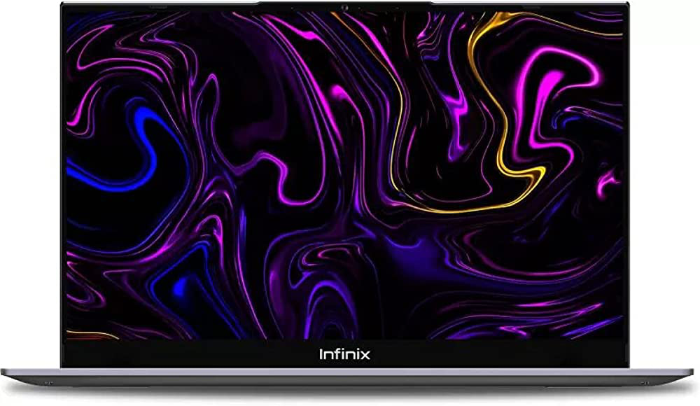
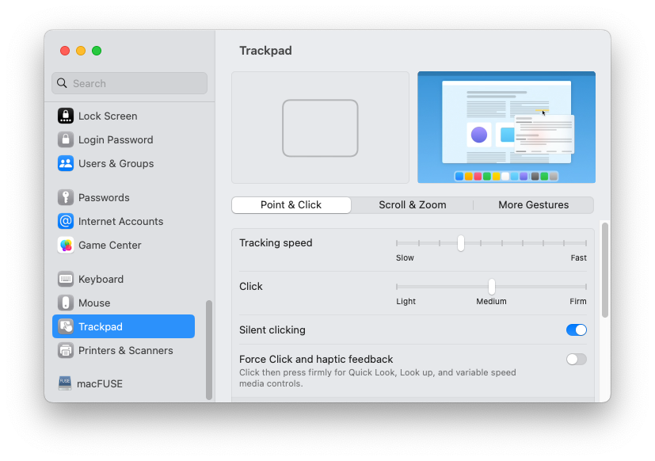

<h1 align="center">Infinix INBook X1 Pro Hackintosh</h1>

<p align="center">
  
</p>

An [OpenCore](https://github.com/acidanthera/OpenCorePkg) EFI for the Infinix INBook X1 Pro 14" (i7-1065G7, Ice Lake).

**Current target: macOS Sequoia 15.8.3 (24H241)**, with working Wi-Fi, Bluetooth, AirDrop, audio, touchpad and display sleep.
System sleep (S3) does **not** work yet; see [Sleep and power](#sleep-and-power).

> [!IMPORTANT]
> The EFI ships with **template SMBIOS values**. Generate your own before you boot it.
> See [Generate your own SMBIOS](#3-generate-your-own-smbios).

---

## Hardware

| Component | Model |
|---|---|
| CPU | Intel Core i7-1065G7 (Ice Lake) |
| iGPU | Intel Iris Plus Graphics G7 (`8086:8a52`) |
| Memory | 16 GB LPDDR4X |
| Wi-Fi / Bluetooth | Intel AX201 CNVi (Bluetooth `8087:0026`) |
| Touchpad | SYNA3602 (I2C) |
| Audio | Realtek ALC269VB |
| Storage | TEAM TM8FP6 512 GB NVMe (MAXIO MAP1202), ADATA Legend 710 NVMe |

## Software stack

| Component | Version | Notes |
|---|---|---|
| OpenCore | 1.0.8 (DEBUG build) | See [Debugging and boot speed](#debugging-and-boot-speed) |
| Lilu | 1.7.2 | |
| VirtualSMC (+ SMCBatteryManager, SMCProcessor, SMCSuperIO) | 1.3.8 | |
| WhateverGreen | 1.7.1 | See [Graphics fix](#graphics-fix-ice-lake-screen-corruption) |
| AppleALC | 1.9.8 | `alcid=16`, `alcverbs=1` |
| VoodooPS2Controller | 2.3.7 | Keyboard |
| VoodooI2C / VoodooI2CHID | **2.6.5** | 2.9.1 is included but disabled: it attaches, but the touchpad stays dead |
| USBToolBox + UTBMap | 1.2.0 | Plug-tested map, `XhciPortLimit` off |
| IntelBluetoothFirmware | 2.4.0 | |
| BlueToolFixup | 2.7.2 | |
| BTLEAdvFixup | 0.9.2 | Required for AirDrop with ForbiddenItlwm |
| ForbiddenItlwm | 0.6.0-beta.1 (Sequoia build) | **Active** Wi-Fi driver (AirDrop capable) |
| AirportItlwm (laobamac fork) | 2.4.0-alpha | Included, **disabled**. Used to install 15.5 |
| itlwm | 2.3.0 | Included, **disabled** |
| IntelBTPatcher | 2.4.0 | Included, **disabled**. Must stay off while BTLEAdvFixup is on |

SMBIOS: `MacBookAir9,1`. `SecureBootModel` is `Disabled`.

## What works

| Feature | Status | Notes |
|---|---|---|
| Graphics acceleration (Iris Plus G7) | ✅ | Needs the framebuffer settings below |
| Built-in display | ✅ | No corruption with the [graphics fix](#graphics-fix-ice-lake-screen-corruption) |
| Display sleep | ✅ | Needs `-nodisplaysleepDC6` (already in boot-args) |
| System sleep (S3) | ❌ | Wakes, but the panel stays black. See [Sleep and power](#sleep-and-power) |
| Hibernation | ❌ | Resume hangs on a blue screen |
| Keyboard | ✅ | VoodooPS2 |
| Touchpad (SYNA3602) | ✅ | VoodooI2C 2.6.5 |
| Speakers | ✅ | `alcid=16` |
| Headphone jack | ✅ | Needs the [headphone fix](#headphone-jack) in `tools/audio/` |
| Built-in microphone | ❓ | Not tested on Sequoia. It did not work on Ventura |
| Wi-Fi (AX201) | ✅ | ForbiddenItlwm |
| Bluetooth (AX201) | ✅ | IntelBluetoothFirmware + BlueToolFixup |
| AirDrop | ✅ | Both directions with an iPhone 11 (iOS 27.0.1). See [AirDrop](#airdrop-forbiddenitlwm) |
| iPhone Mirroring | ❌ | Needs a T2 Mac. Not possible on this hardware |
| USB ports | ✅ | Plug-tested USB map (see [USB map](#usb-map)) |



---

## Installation

### 1. BIOS settings

Disable:
* Secure Boot
* Wake on WLAN and Bluetooth (Chipset > PCH IO > disable wake on WLAN+BT)
* VT-d (Advanced > CPU > Virtualization Technology)

Enable / set, if your BIOS shows them:
* `DVMT Pre-Allocated` to `64MB` or `MAX` (Advanced > System Agent (SA) Configuration > Graphics Configuration)
* `DVMT Total Gfx Mem` to `MAX` (same menu)
* Intel Virtualization Technology (Advanced > CPU Configuration)

If a setting is not in your BIOS, skip it.

### 2. Create the USB installer

15.8.3 was installed with the **full installer** (`InstallAssistant.pkg` for 15.8.3 from Apple's software update CDN, `swcdn.apple.com`).

1. On a Mac, run `InstallAssistant.pkg`. It puts *Install macOS Sequoia.app* in `/Applications`.
2. Make the USB stick with `createinstallmedia`:
   ```sh
   sudo /Applications/Install\ macOS\ Sequoia.app/Contents/Resources/createinstallmedia --volume /Volumes/<USB>
   ```
3. Mount the USB stick's EFI partition and copy this repository's `EFI` folder to it.

Use the full installer for updates as well. Because `SecureBootModel` is `Disabled`, Software Update does not offer macOS updates.

#### USB rescue variant

For a USB stick that you keep as a rescue disk, change two keys in its copy of `config.plist`:

| Key | Daily (this repo) | USB rescue |
|---|---|---|
| `Misc/Boot/LauncherOption` | `Full` | `Disabled` |
| `Misc/Debug/Target` | `21` (`0x15`) | `67` (`0x43`) |

`Disabled` stops the USB copy of OpenCore from registering itself in the firmware boot order. `0x43` adds on-screen and file logging, which is useful when the internal EFI fails, but slow (see below).

### 3. Generate your own SMBIOS

The published `config.plist` contains template values:

| Field | Template value |
|---|---|
| `SystemSerialNumber` | `XXXXXXXXXXXXX` |
| `MLB` | `XXXXXXXXXXXXXXXXX` |
| `SystemUUID` | `XXXXXXXX-XXXX-XXXX-XXXX-XXXXXXXXXXXX` |
| `ROM` | `112233445566` (ASCII placeholder) |

Replace all four before you boot. An earlier revision of this repository published a real serial number, so **do not reuse any serial you find in this repository's history**. A serial that someone else also uses causes iCloud and iMessage problems for both of you.

1. Get `macserial` from the [OpenCorePkg release](https://github.com/acidanthera/OpenCorePkg/releases) (`Utilities/macserial`) or use [GenSMBIOS](https://github.com/corpnewt/GenSMBIOS).
2. Generate values for **`MacBookAir9,1`** (the model in the config):
   ```sh
   ./macserial -m MacBookAir9,1 -n 1
   ```
   The output is `Serial | Board Serial`. Put them in `SystemSerialNumber` and `MLB`.
3. Generate `SystemUUID` with `uuidgen`.
4. Set `ROM` to 6 bytes of data, for example your Wi-Fi MAC address. With the template value, `ocvalidate` reports an error for `ROM` and `SystemUUID`; with real values it reports no issues.
5. Check the serial at <https://checkcoverage.apple.com/>. "Unable to check coverage" is what you want. A valid purchase date means the serial is in use: generate another.

### 4. Install macOS

1. Boot the USB stick and install macOS.
2. After the installer finishes, boot macOS from the USB stick again.
3. Mount the internal ESP and copy the `EFI` folder to it:
   ```sh
   sudo diskutil mount disk0s1        # check `diskutil list` for your ESP
   ```
4. Reboot without the USB stick.

With `LauncherOption` set to `Full`, OpenCore adds itself to the firmware boot menu and keeps itself first in the boot order on every boot, so a Windows update cannot replace it as the default.

### Dual boot with Windows

1. Install macOS first and back up your EFI folder.
2. Install Windows.
3. Copy the EFI folder back to the ESP. Replace files if asked.

---

## AirDrop (ForbiddenItlwm)

AirDrop works in both directions with an iPhone 11 on 15.8.3. On the Mac, `ioreg` shows `ItlwmAWDLBuildCheck=verified`, `awdl0` is up, and AWDL uses channel 149.

The AirDrop setup is:
* `ForbiddenItlwm.kext` and `BTLEAdvFixup.kext` enabled.
* `AirportItlwm.kext`, `itlwm.kext` and `IntelBTPatcher.kext` disabled. IntelBTPatcher must stay off while BTLEAdvFixup is on.
* The ForbiddenItlwm AWDL flags in `boot-args` (`-btleadv -itlawdlcoexprobe … itlawdltxqueue=4096`).

> [!WARNING]
> ForbiddenItlwm enables AirDrop only on builds **24H23, 24H32, 24H232 and 24H241** (15.8 to 15.8.3).
> Before a macOS update, switch back to plain Wi-Fi:
> ```sh
> sudo bash tools/airdrop-mode.sh off /Volumes/EFI/EFI/OC/config.plist
> ```
> Update, check that ForbiddenItlwm supports the new build, then run `airdrop-mode.sh on`.

`airdrop-mode.sh off` enables AirportItlwm and IntelBTPatcher and removes the AWDL flags. `on` does the opposite. The script saves a `.bak` copy of the config first.

Check AirDrop after a reboot:
```sh
ioreg -l -w0 | grep -E '"ItlwmAWDL(InterfaceBuild|BuildCheck)"|"ITLAWDLCoex(Added|Channel|CountryLearned)"'
```

## Graphics fix (Ice Lake screen corruption)

With the old framebuffer the screen showed tiled corruption. The kernel log showed `Display Pipe Underrun` and `Failed to distribute DBufs`. Two `DeviceProperties` for `PciRoot(0x0)/Pci(0x2,0x0)` fix it:

| Property | Value |
|---|---|
| `AAPL,ig-platform-id` | `0000528A` (`0x8A520000`) |
| `dbuf-optimizer-delay` | `02000000` (2 seconds) |

Do not use these platform IDs on this laptop:
* `0x8A5C0001`: screen corruption.
* `0x8A510002`: screen corruption, and the cursor and touchpad stop working.

`tools/gfx-test.sh` applies one graphics change at a time against a saved baseline. Use it if you need to test other values.

## Sleep and power

* **Display sleep works** with `-nodisplaysleepDC6`. Without it, the panel does not come back (`[PANEL] Timeout waiting for HPD`, AUX `HPD is low`).
* **System sleep (S3) is broken.** The system wakes, but eDP HPD stays low, link training phase 1 fails and the display stays black.
* **Hibernation does not work.** With `hibernatemode 25` and OpenCore `HibernateMode` set to `NVRAM` or `Auto`, there is no hibernation marker and resume hangs on a blue screen.

Until S3 is fixed, disable system sleep and keep display sleep:
```sh
sudo bash tools/nosleep.sh /Volumes/EFI/EFI/OC/config.plist
```
This sets `displaysleep 10`, `sleep 0`, `disablesleep 1`, turns hibernation off, and sets OpenCore `HibernateMode` to `None`.

## Boot arguments

```
-v keepsyms=1 swd_panic=1 -igfxcdc -igfxdvmt igfxonln=1 -igfxblr igfxfw=2 -igfxdbeo -wegnoegpu agdpmod=vit9696 -noDC9 debug=0x100 forceRenderStandby=0 -nodisplaysleepDC6 alcid=16 alcverbs=1
```
plus the ForbiddenItlwm AWDL flags (`-btleadv … itlawdltxqueue=4096`).

`-v` (verbose boot) and `debug=0x100` are there for debugging. Remove them for daily use. Keep `alcverbs=1`: the [headphone fix](#headphone-jack) needs it.

## Headphone jack

With `alcid=16`, the speakers work and the headphone jack is detected and routed (macOS switches the output to Headphones, pin `0x21` is unmuted and DAC `0x03` streams), but the headphones are silent.

The cause is a Realtek vendor coefficient. Coefficient `0x04` reads `0x9027`. Bit 11 ("power up output pin") is not set, so the headphone output stays powered down. Linux sets this bit for every ALC269VB (`alc269vb_toggle_power_output` in the kernel's Realtek HDA driver). Writing `0x9827` makes the headphones play at once. The value survives codec idle (D3).

Other layouts do not help: `alcid=26` keeps the speakers but the jack stays silent, and `alcid=99` loses both.

`tools/audio/` installs a LaunchDaemon that sets the bit at boot and checks it every 60 seconds. When the bit is already set, it does nothing. The daemon uses AppleALC's `alc-verb` tool, which needs the `alcverbs=1` boot-arg (already in the config).

Install:
1. Download the [AppleALC 1.9.8](https://github.com/acidanthera/AppleALC/releases/tag/1.9.8) RELEASE zip and copy `alc-verb` from it into `tools/audio/`, next to `install-hpfix.sh`.
2. Run:
   ```sh
   cd tools/audio
   sudo bash install-hpfix.sh
   ```

Verify:
```sh
cat /var/log/alc269vb-hpfix.log          # one line per change, e.g. "coef04 0x9027 -> 0x9827"
sudo /usr/local/libexec/alc-verb 0x20 SET_COEF_INDEX 0x04
sudo /usr/local/libexec/alc-verb 0x20 GET_PROC_COEF 0  # expect 0x9827
```

Uninstall:
```sh
sudo launchctl bootout system/com.infinix.alc269vb-hpfix
sudo rm /Library/LaunchDaemons/com.infinix.alc269vb-hpfix.plist /usr/local/libexec/alc269vb-hpfix.sh /usr/local/libexec/alc-verb
```

## Debugging and boot speed

The EFI uses the OpenCore **DEBUG** build. `Misc/Debug/Target` is `0x15` (logging enabled, to DataHub and a UEFI variable, no file). With this target OpenCore reaches `boot.efi` in about 3 seconds.

`Target` `0x43` adds on-screen logging and writes a log file to the ESP. That is useful when the system does not boot, but on a USB stick it made the OpenCore stage take about 4 minutes. Use it only on the rescue USB.

## USB map

`UTBMap.kext` (USBToolBox) was built from a plug test of every port:

| Port | Use |
|---|---|
| HS01, HS02 | USB-C |
| HS04, HS06, HS07 | USB-A |
| HS03 | Webcam |
| HS05 | Card reader |
| HS10 | Bluetooth |

`XhciPortLimit` is off. To rebuild the map, run `tools/watch-ports.sh` under Linux while you plug devices into each port, edit `tools/build_utbmap.py` and run it.

## Touchpad

The published config uses VoodooI2C/VoodooI2CHID **2.6.5** with the stock DSDT `GpioInt`. VoodooI2C 2.9.1 is included but disabled: it attaches on 15.8.3, but the touchpad does not respond.

`tools/touchpad-mode.sh` switches between the 2.6.5 set (`v265`), 2.9.1 (`native`), and two disabled fallback SSDTs (`SSDT-TPD0-GPIO`, `SSDT-TPD0-POLL`, plus `SSDT-GPI0`).

## Tools

The shell scripts in [`tools/`](tools) run on macOS with `sudo`, except `watch-ports.sh`. Most of them change `config.plist` on a mounted ESP. Each script describes its usage in its header.

| Script | Purpose |
|---|---|
| `airdrop-mode.sh on\|off <config>` | Switch between ForbiddenItlwm (AirDrop) and AirportItlwm (plain Wi-Fi) |
| `nosleep.sh <config>` | Display-sleep-only power policy |
| `gfx-test.sh <step> <config>` | One-change-at-a-time iGPU experiments |
| `touchpad-mode.sh <mode> <config>` | Switch the VoodooI2C version and touchpad SSDTs |
| `watch-ports.sh` | USB port watcher (runs under **Linux**) |
| `build_utbmap.py` | Generate `UTBMap.kext` (any OS, Python 3) |
| `audio/install-hpfix.sh` | Install the [headphone fix](#headphone-jack) LaunchDaemon |

---

## Credits

* [acidanthera](https://github.com/acidanthera): OpenCore, Lilu, VirtualSMC, WhateverGreen, AppleALC, VoodooPS2, BrightnessKeys, NVMeFix, BlueToolFixup
* [OpenIntelWireless](https://github.com/OpenIntelWireless): itlwm, IntelBluetoothFirmware
* [laobamac/itlwm](https://github.com/laobamac/itlwm): AirportItlwm for Sequoia
* [retropineaple/ForbiddenItlwm](https://github.com/retropineaple/ForbiddenItlwm): AirDrop-capable itlwm and BTLEAdvFixup
* [VoodooI2C](https://github.com/VoodooI2C/VoodooI2C): I2C touchpad
* [USBToolBox](https://github.com/USBToolBox/kext): USB mapping
* [Dortania](https://dortania.github.io/OpenCore-Install-Guide/): OpenCore install guides

## Disclaimer

Use this EFI at your own risk. I am not responsible for any damage it causes.
